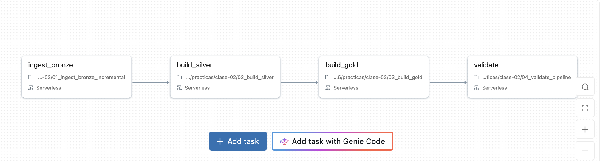
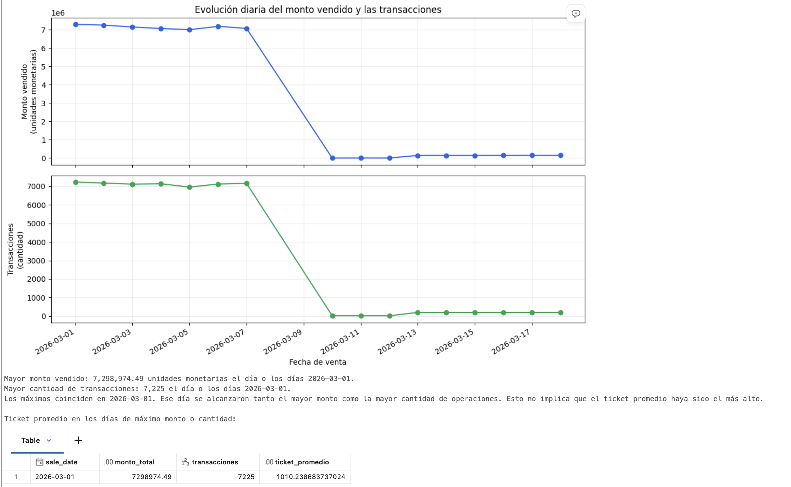
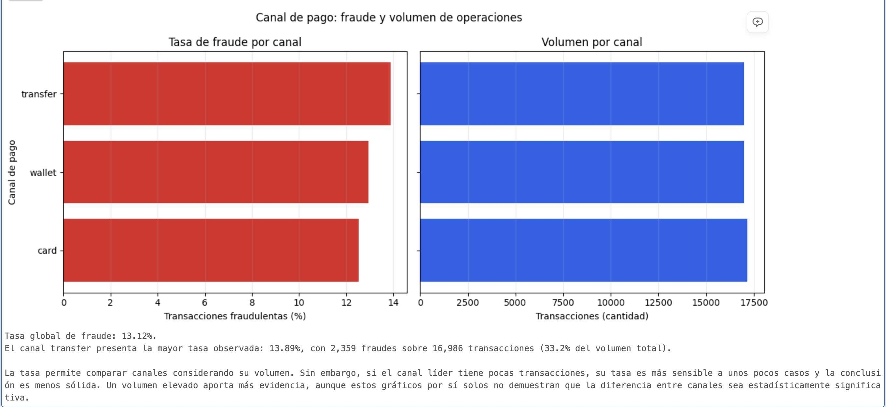
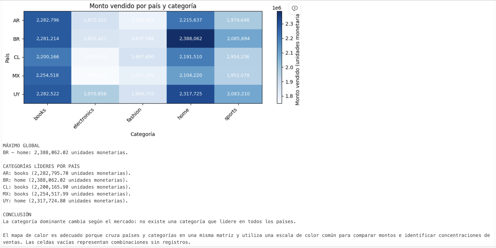
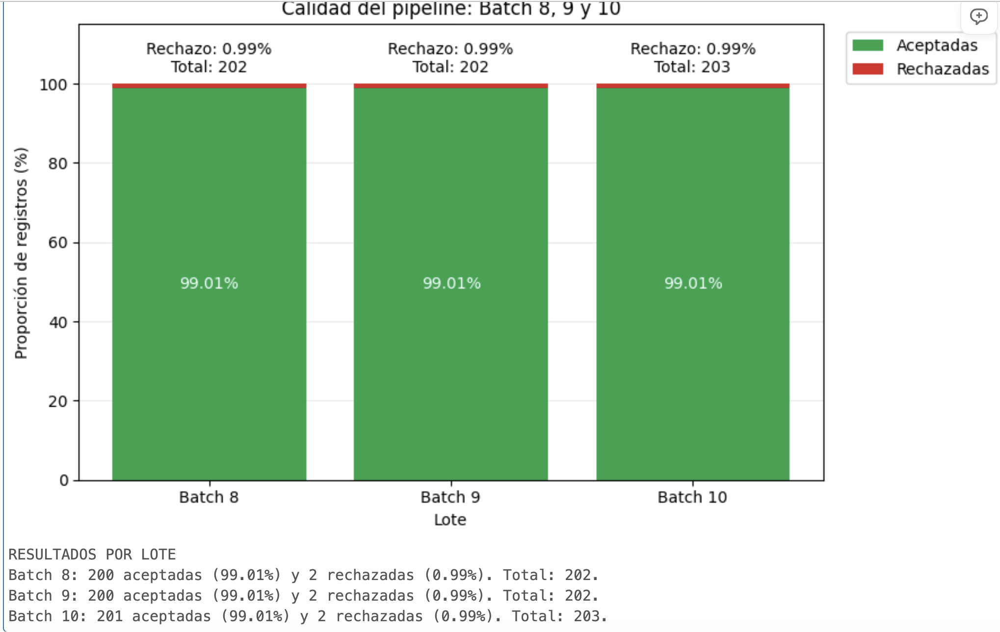

# Resolución — Práctica 2: Silver, Gold y orquestación

## Datos del alumno

- Nombre: Ricardo Aníbal Cheluja
- student_id: drrach
- Escala: small
- Catálogo y esquema: workspace.bigdata_drrach

## Job y dependencias

- Nombre exacto del Job: bigdata_2<student_id>_silver_gold
- URL del Job: [•	https://dbc-4b1b6668-73d5.cloud.databricks.com/jobs/302407002750599?o=7474651579613320]

Las tareas se ejecutan en este orden:

ingest_bronze → build_silver → build_gold → validate

Cada tarea posterior se ejecuta únicamente si su dependencia
terminó correctamente.

### DAG del Job



## Primera y segunda ejecución

La segunda ejecución se realizó sin volver a ejecutar el generador,
manteniendo los mismos parámetros y archivos de entrada.

### Primera y segunda ejecución — batch_008

| Métrica | Primera ejecución | Segunda ejecución |
|---|---:|---:|
| Cantidad de transacciones en Silver | 51146 | 51146 |
| Cantidad de registros en cuarentena | 69 | 69 |
| Cantidad de filas de gold_daily_sales | 1003 | 1003 |
| Monto total en Gold | 50942317.39 | 50942317.39 |
| idempotence_compared | False | True |
| ID de ejecución | 1117264922659891 | 1072656153727934 |
| Estado de validate | Succeeded | Succeeded |

Las métricas de negocio fueron iguales en ambas ejecuciones del Job.
Entre ambas hubo ejecuciones interactivas de validación. La segunda
ejecución del Job comparó sus métricas con el registro inmediatamente
anterior de la auditoría y superó el control de igualdad.
La auditoría agregó una fila por cada ejecución de validate.

### Cantidades aceptadas y rechazadas — batch_008

| Lote | Aceptadas | Rechazadas |
|---|---:|---:|
| batch_008 | 200 | 2 |

Según gold_batch_summary, el lote batch_008 tiene 200 transacciones
aceptadas y 2 registros rechazados.

## Reconciliación de batch_008

| Concepto | Cantidad |
|---|---:|
| Filas físicas recibidas en Bronze | 204 |
| Aceptadas según el resumen del lote | 200 |
| Rechazadas según el resumen del lote | 2 |
| Transacciones vigentes en Silver del lote | 200 |

Las 200 transacciones aceptadas del resumen coinciden con las
200 transacciones vigentes en Silver del lote.

Bronze contiene 204 filas físicas. Las aceptadas y rechazadas suman
202, por lo que hay 2 filas adicionales cuya causa debe verificarse
en Bronze; estos conteos por sí solos no permiten determinar si son
duplicados o versiones anteriores.

Consultas utilizadas:

```sql
SELECT *
FROM workspace.bigdata_drrach.gold_batch_summary
WHERE source_batch_id = 'batch_008';

SELECT
    'Filas físicas recibidas en Bronze' AS concepto,
    COUNT(*) AS cantidad
FROM workspace.bigdata_drrach.bronze_transactions_incremental
WHERE source_batch_id = 'batch_008'

UNION ALL

SELECT
    'Transacciones vigentes en Silver del lote' AS concepto,
    COUNT(*) AS cantidad
FROM workspace.bigdata_drrach.silver_transactions
WHERE source_batch_id = 'batch_008';
```
## Por qué COPY INTO y MERGE resuelven problemas diferentes

COPY INTO controla la incorporación de archivos a Bronze y evita
volver a cargar un archivo ya procesado en condiciones normales.
Su unidad de control es el archivo.

MERGE compara los registros de entrada con los existentes mediante
la clave y las condiciones definidas en el pipeline. Permite insertar
transacciones nuevas y actualizar las existentes con correcciones.

Por eso, evitar repetir archivos no alcanza para resolver duplicados
o correcciones que llegan dentro de archivos nuevos. Para mantener
una sola versión por transaction_id también se necesita deduplicar
la entrada y aplicar correctamente el MERGE.

## Visualizaciones y respuestas

### Pregunta 1

**Enunciado:** ¿Qué día tuvo el mayor monto vendido y ese día también fue el de mayor cantidad de transacciones?



**Respuesta:** 

**Consulta utilizada:**

```# Agregar con Spark antes de convertir a Pandas.
from pyspark.sql import functions as F
import matplotlib.pyplot as plt

# Agregar con Spark antes de convertir a Pandas.
daily_totals = (
    spark.table(daily)
    .groupBy("sale_date")
    .agg(
        F.sum("total_amount").alias("monto_total"),
        F.sum("transaction_count").alias("transacciones")
    )
    .withColumn(
        "ticket_promedio",
        F.when(
            F.col("transacciones") > 0,
            F.col("monto_total") / F.col("transacciones")
        )
    )
    .orderBy("sale_date")
)

assert daily_totals.count() > 0, "La tabla Gold no contiene datos."

# Sólo el resultado agregado se convierte a Pandas.
plot_data = daily_totals.toPandas()
plot_data["monto_total"] = plot_data["monto_total"].astype(float)

fig, axes = plt.subplots(2, 1, figsize=(11, 7), sharex=True)

axes[0].plot(
    plot_data["sale_date"],
    plot_data["monto_total"],
    marker="o",
    color="#2563eb"
)
axes[0].set_title("Evolución diaria del monto vendido y las transacciones")
axes[0].set_ylabel("Monto vendido\n(unidades monetarias)")
axes[0].grid(alpha=0.25)

axes[1].plot(
    plot_data["sale_date"],
    plot_data["transacciones"],
    marker="o",
    color="#16a34a"
)
axes[1].set_ylabel("Transacciones\n(cantidad)")
axes[1].set_xlabel("Fecha de venta")
axes[1].grid(alpha=0.25)

fig.autofmt_xdate()
fig.tight_layout()
plt.show()

# Identificar máximos, incluyendo posibles empates.
max_monto = plot_data["monto_total"].max()
max_transacciones = plot_data["transacciones"].max()

dias_monto = set(
    plot_data.loc[
        plot_data["monto_total"] == max_monto, "sale_date"
    ]
)
dias_transacciones = set(
    plot_data.loc[
        plot_data["transacciones"] == max_transacciones, "sale_date"
    ]
)

def fechas(dias):
    return ", ".join(str(dia) for dia in sorted(dias))

print(
    f"Mayor monto vendido: {max_monto:,.2f} unidades monetarias "
    f"el día o los días {fechas(dias_monto)}."
)
print(
    f"Mayor cantidad de transacciones: {max_transacciones:,.0f} "
    f"el día o los días {fechas(dias_transacciones)}."
)

coinciden = dias_monto & dias_transacciones

if coinciden:
    print(
        f"Los máximos coinciden en {fechas(coinciden)}. "
        "Ese día se alcanzaron tanto el mayor monto como la mayor "
        "cantidad de operaciones. Esto no implica que el ticket "
        "promedio haya sido el más alto."
    )
else:
    print(
        "Los máximos no coinciden. El día de mayor monto tuvo menos "
        "operaciones que el día de mayor cantidad de transacciones, "
        "pero un ticket promedio más alto: cada operación aportó, "
        "en promedio, más dinero."
    )

print("\nTicket promedio en los días de máximo monto o cantidad:")
display(
    daily_totals.where(
        (F.col("monto_total") == F.lit(max_monto)) |
        (F.col("transacciones") == F.lit(int(max_transacciones)))
    )
)

```

### Pregunta 2

**Enunciado:** ¿Qué canal de pago presenta la mayor tasa de fraude? ¿La conclusión se sostiene al considerar el número de transacciones de cada canal?



**Consulta utilizada:**

```# Tu solución. Recalculá la tasa global como suma(fraud_transactions) / suma(transaction_count).
# Evitá promediar directamente fraud_rate entre grupos.

from pyspark.sql import functions as F
import matplotlib.pyplot as plt

gold = spark.table(daily)

# Identificar el nombre de la columna de canal.
channel_col = next(
    (c for c in ["payment_channel", "channel", "payment_method"]
     if c in gold.columns),
    None
)

assert channel_col is not None, (
    f"No se encontró la columna de canal. Columnas: {gold.columns}"
)

# Agregar con Spark: no promediar fraud_rate.
channel_metrics = (
    gold.groupBy(channel_col)
    .agg(
        F.sum("fraud_transactions").alias("fraudes"),
        F.sum("transaction_count").alias("transacciones")
    )
    .where(F.col("transacciones") > 0)
    .withColumn(
        "tasa_fraude_pct",
        100.0 * F.col("fraudes") / F.col("transacciones")
    )
    .orderBy(F.desc("tasa_fraude_pct"), F.desc("transacciones"))
)

display(channel_metrics)

# Convertir únicamente el resultado agregado.
plot_data = channel_metrics.toPandas()
assert not plot_data.empty, "No hay transacciones para analizar."

plot_data["tasa_fraude_pct"] = (
    plot_data["tasa_fraude_pct"].astype(float)
)
labels = plot_data[channel_col].fillna("Sin canal").astype(str)

fig, axes = plt.subplots(1, 2, figsize=(12, 5), sharey=True)
positions = list(range(len(plot_data)))

axes[0].barh(
    positions, plot_data["tasa_fraude_pct"], color="#dc2626"
)
axes[0].set_yticks(positions)
axes[0].set_yticklabels(labels)
axes[0].invert_yaxis()
axes[0].set_title("Tasa de fraude por canal")
axes[0].set_xlabel("Transacciones fraudulentas (%)")
axes[0].set_ylabel("Canal de pago")
axes[0].grid(axis="x", alpha=0.25)

axes[1].barh(
    positions, plot_data["transacciones"], color="#2563eb"
)
axes[1].set_title("Volumen por canal")
axes[1].set_xlabel("Transacciones (cantidad)")
axes[1].grid(axis="x", alpha=0.25)

fig.suptitle("Canal de pago: fraude y volumen de operaciones")
fig.tight_layout()
plt.show()

# Tasa global: suma de fraudes / suma de transacciones.
totals = channel_metrics.agg(
    F.sum("fraudes").alias("fraudes"),
    F.sum("transacciones").alias("transacciones")
).first()

global_rate = 100 * totals.fraudes / totals.transacciones

max_rate = plot_data["tasa_fraude_pct"].max()
leaders = plot_data[
    plot_data["tasa_fraude_pct"] == max_rate
]

print(f"Tasa global de fraude: {global_rate:.2f}%.")

for _, row in leaders.iterrows():
    share = 100 * row["transacciones"] / totals.transacciones
    print(
        f"El canal {row[channel_col]} presenta la mayor tasa observada: "
        f"{row['tasa_fraude_pct']:.2f}%, con "
        f"{int(row['fraudes']):,} fraudes sobre "
        f"{int(row['transacciones']):,} transacciones "
        f"({share:.1f}% del volumen total)."
    )

print(
    "\nLa tasa permite comparar canales considerando su volumen. "
    "Sin embargo, si el canal líder tiene pocas transacciones, "
    "su tasa es más sensible a unos pocos casos y la conclusión "
    "es menos sólida. Un volumen elevado aporta más evidencia, "
    "aunque estos gráficos por sí solos no demuestran que la "
    "diferencia entre canales sea estadísticamente significativa."
)
```
**Respuesta:** 
La combinación que genera el mayor monto vendido es Brasil (BR) y la categoría home, con 2.388.062,02 unidades monetarias. No existe una categoría dominante en todos los países: books lidera en Argentina, Chile y México, mientras que home encabeza las ventas en Brasil y Uruguay. En Chile, la diferencia entre ambas es pequeña: aproximadamente 8.655 unidades monetarias.

### Pregunta 3 

**Enunciado:** ¿Qué combinación de país y categoría genera el mayor monto? ¿Existe una categoría dominante en todos los países o cambia según el mercado?

 

**Consulta utilizada:**

```from pyspark.sql import functions as F
import pandas as pd
import matplotlib.pyplot as plt

# Agregar con Spark antes de convertir a Pandas.
country_category = (
    spark.table(daily)
    .groupBy("country", "category")
    .agg(F.sum("total_amount").alias("monto_total"))
)

plot_data = country_category.toPandas()
assert not plot_data.empty, "No hay datos para analizar."

plot_data["monto_total"] = plot_data["monto_total"].astype(float)
plot_data["country"] = plot_data["country"].fillna("Sin país")
plot_data["category"] = plot_data["category"].fillna("Sin categoría")

matrix = plot_data.pivot_table(
    index="country",
    columns="category",
    values="monto_total",
    aggfunc="sum"
).sort_index()

# Los pares sin registros quedan vacíos, no se interpretan como cero.
fig, ax = plt.subplots(
    figsize=(max(9, len(matrix.columns) * 1.5),
             max(4, len(matrix.index) * 0.7))
)

heatmap = ax.imshow(
    matrix.to_numpy(dtype=float),
    cmap="Blues",
    aspect="auto"
)

ax.set_xticks(range(len(matrix.columns)))
ax.set_xticklabels(matrix.columns, rotation=45, ha="right")
ax.set_yticks(range(len(matrix.index)))
ax.set_yticklabels(matrix.index)
ax.set_title("Monto vendido por país y categoría")
ax.set_xlabel("Categoría")
ax.set_ylabel("País")

fig.colorbar(
    heatmap, ax=ax,
    label="Monto vendido (unidades monetarias)"
)

# Anotar los montos para facilitar la comparación.
threshold = plot_data["monto_total"].max() / 2

for i in range(len(matrix.index)):
    for j in range(len(matrix.columns)):
        value = matrix.iloc[i, j]
        if pd.notna(value):
            ax.text(
                j, i, f"{value:,.0f}",
                ha="center", va="center",
                color="white" if value > threshold else "black",
                fontsize=9
            )

fig.tight_layout()
plt.show()

# Máximo global, incluyendo posibles empates.
global_max = plot_data["monto_total"].max()
global_leaders = plot_data[
    plot_data["monto_total"] == global_max
]

print("MÁXIMO GLOBAL")
for _, row in global_leaders.iterrows():
    print(
        f"{row['country']} — {row['category']}: "
        f"{row['monto_total']:,.2f} unidades monetarias."
    )

# Categorías líderes por país, incluyendo empates.
country_max = plot_data.groupby("country")["monto_total"].transform("max")
leaders = plot_data[
    plot_data["monto_total"] == country_max
].sort_values(["country", "category"])

print("\nCATEGORÍAS LÍDERES POR PAÍS")
for _, row in leaders.iterrows():
    print(
        f"{row['country']}: {row['category']} "
        f"({row['monto_total']:,.2f} unidades monetarias)."
    )

leader_sets = leaders.groupby("country")["category"].apply(set)
common_leaders = set.intersection(*leader_sets.tolist())

print("\nCONCLUSIÓN")
if common_leaders:
    categories = ", ".join(sorted(common_leaders))
    print(
        f"{categories} alcanza el mayor monto en todos los países "
        "observados, considerando posibles empates."
    )
else:
    print(
        "La categoría dominante cambia según el mercado: "
        "no existe una categoría que lidere en todos los países."
    )

print(
    "\nEl mapa de calor es adecuado porque cruza países y categorías "
    "en una misma matriz y utiliza una escala de color común para "
    "comparar montos e identificar concentraciones de ventas. "
    "Las celdas vacías representan combinaciones sin registros."
)
```

### Pregunta 4

**Enunciado:** ¿Qué proporción de cada lote fue aceptada y rechazada? ¿El lote nuevo presenta una calidad diferente del lote inicial?



**Consulta utilizada:**

```from pyspark.sql import functions as F
import matplotlib.pyplot as plt

# Calcular cantidades y proporciones con Spark.
batch_quality = (
    spark.table(batch)
    .groupBy("source_batch_id")
    .agg(
        F.sum("accepted_transactions").alias("aceptadas"),
        F.sum("rejected_transactions").alias("rechazadas")
    )
    .withColumn("total", F.col("aceptadas") + F.col("rechazadas"))
    .withColumn(
        "aceptadas_pct",
        F.when(F.col("total") > 0, 100.0 * F.col("aceptadas") / F.col("total"))
    )
    .withColumn(
        "rechazadas_pct",
        F.when(F.col("total") > 0, 100.0 * F.col("rechazadas") / F.col("total"))
    )
    .orderBy("source_batch_id")
)

display(batch_quality)

# Convertir sólo el resumen a Pandas.
plot_data = batch_quality.where(F.col("total") > 0).toPandas()
assert not plot_data.empty, "No hay lotes con registros para comparar."

labels = plot_data["source_batch_id"].fillna("Sin lote").astype(str)

fig, ax = plt.subplots(figsize=(10, 5))

ax.bar(
    labels, plot_data["aceptadas_pct"],
    label="Aceptadas", color="#16a34a"
)
ax.bar(
    labels, plot_data["rechazadas_pct"],
    bottom=plot_data["aceptadas_pct"],
    label="Rechazadas", color="#dc2626"
)

for i, row in plot_data.iterrows():
    accepted_pct = float(row["aceptadas_pct"])
    rejected_pct = float(row["rechazadas_pct"])

    ax.text(
        i, accepted_pct / 2,
        f"{accepted_pct:.1f}%",
        ha="center", va="center", color="white"
    )
    ax.text(
        i, 102,
        f"Rechazo: {rejected_pct:.1f}%\nn={int(row['total']):,}",
        ha="center", va="bottom", fontsize=9
    )

ax.set_title("Calidad del pipeline: aceptación y rechazo por lote")
ax.set_xlabel("Lote")
ax.set_ylabel("Proporción de registros (%)")
ax.set_ylim(0, 115)
ax.set_yticks([0, 20, 40, 60, 80, 100])
ax.legend(loc="upper left", bbox_to_anchor=(1.02, 1))
ax.grid(axis="y", alpha=0.25)

fig.tight_layout()
plt.show()

print("RESULTADOS POR LOTE")
for _, row in plot_data.iterrows():
    print(
        f"{row['source_batch_id']}: "
        f"{int(row['aceptadas']):,} aceptadas "
        f"({row['aceptadas_pct']:.2f}%) y "
        f"{int(row['rechazadas']):,} rechazadas "
        f"({row['rechazadas_pct']:.2f}%). "
        f"Total: {int(row['total']):,}."
    )

# Completar con los identificadores reales del resumen.
initial_batch_id = "batch_001"
new_batch_id = "batch_003"  # Usar "batch_002" si ése es el lote nuevo.

initial = plot_data[
    plot_data["source_batch_id"] == initial_batch_id
]
new = plot_data[
    plot_data["source_batch_id"] == new_batch_id
]

print("\nCOMPARACIÓN")
if initial.empty or new.empty:
    print(
        "No se encontraron ambos lotes seleccionados. "
        "Revisá initial_batch_id y new_batch_id con los nombres "
        "que aparecen en la tabla. Si el lote inicial no está "
        "incluido en Gold, no puede compararse con esta fuente."
    )
else:
    initial_rate = float(initial.iloc[0]["rechazadas_pct"])
    new_rate = float(new.iloc[0]["rechazadas_pct"])
    difference = new_rate - initial_rate

    print(
        f"Rechazo inicial ({initial_batch_id}): {initial_rate:.2f}%. "
        f"Rechazo nuevo ({new_batch_id}): {new_rate:.2f}%."
    )

    if abs(difference) < 1e-9:
        print("Ambos lotes presentan la misma proporción de rechazo.")
    elif difference > 0:
        print(
            f"El lote nuevo presenta {difference:.2f} puntos "
            "porcentuales más de rechazo: menor aceptación "
            "bajo las reglas de calidad del pipeline."
        )
    else:
        print(
            f"El lote nuevo presenta {abs(difference):.2f} puntos "
            "porcentuales menos de rechazo: mayor aceptación "
            "bajo las reglas de calidad del pipeline."
        )

print(
    "\nLIMITACIONES: los porcentajes permiten comparar lotes de "
    "distintos tamaños, pero en lotes pequeños unos pocos rechazos "
    "pueden cambiar mucho la tasa. La comparación presupone las "
    "mismas reglas de validación. Además, una mayor aceptación no "
    "garantiza que todos los datos sean correctos; si el generador "
    "introduce errores deliberadamente, el rechazo refleja esa prueba."
)

```
**Respuesta:**
**Fuente:** `workspace.bigdata_drrach.gold_batch_summary`.

| Lote | Aceptadas | Rechazadas | Total | % aceptadas | % rechazadas |
|---|---:|---:|---:|---:|---:|
| Inicial (`initial`) | 49.882 | 51 | 49.933 | 99,90 % | 0,10 % |
| Batch 8 (`batch_008`) | 200 | 2 | 202 | 99,01 % | 0,99 % |
| Batch 9 (`batch_009`) | 200 | 2 | 202 | 99,01 % | 0,99 % |
| Batch 10 (`batch_010`) | 201 | 2 | 203 | 99,01 % | 0,99 % |

Las proporciones se calcularon utilizando:

- **Total:** aceptadas + rechazadas.
- **Porcentaje de aceptación:** aceptadas / total × 100.
- **Porcentaje de rechazo:** rechazadas / total × 100.

**Comparación:** los lotes nuevos presentan una mayor proporción de rechazo que el inicial: aproximadamente 0,99 % frente a 0,10 %, una diferencia cercana a 0,89 puntos porcentuales. Por lo tanto, muestran una menor aceptación según las reglas de validación del pipeline. Los tres lotes nuevos tienen proporciones prácticamente iguales.

En cantidades absolutas, el lote inicial tiene más rechazos: 51 frente a 2 por lote nuevo. Sin embargo, contiene muchos más registros, por lo que su tasa de rechazo es menor. Esto demuestra la importancia de comparar porcentajes además de cantidades.

**Limitaciones:** los tamaños son muy distintos. En un lote de unos 200 registros, cada rechazo representa aproximadamente 0,5 puntos porcentuales, por lo que unos pocos casos modifican mucho la tasa. La diferencia observada no demuestra por sí sola un deterioro sistemático de la calidad. La comparación también supone las mismas reglas de validación y debe considerar diferencias en la composición de los datos o errores introducidos deliberadamente por el generador. La aceptación no garantiza que todos los datos sean correctos.

## Las 20 preguntas de análisis y comprensión

### Pregunta 1

**Enunciado:** [copiar enunciado]

**Respuesta:** [respuesta y resultados cuando corresponda]

**Consulta utilizada, si corresponde:**

```sql
-- Pegar consulta real.
```

[Repetir esta estructura para las preguntas 2 a 20.]
